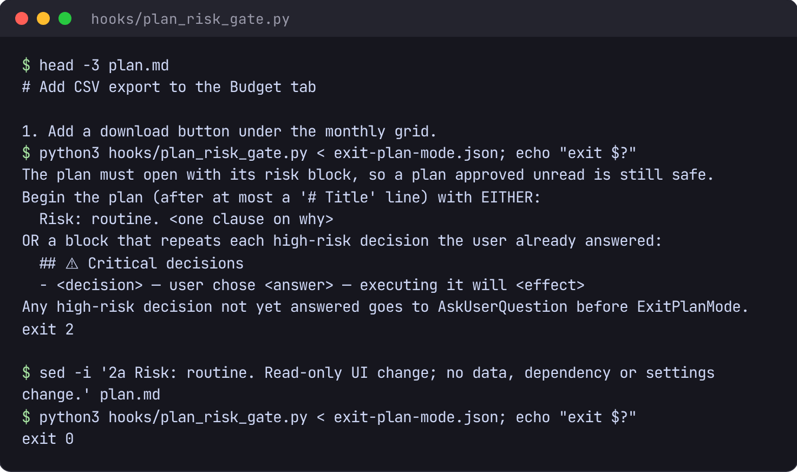
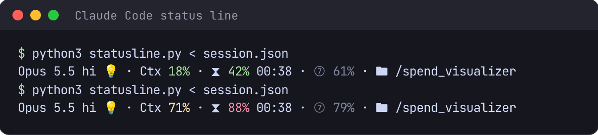
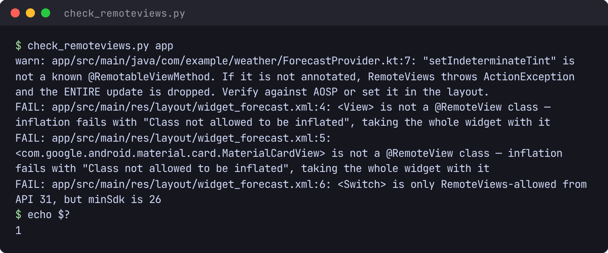

# claude-code-toolkit

[](https://github.com/ethanez713/claude-code-toolkit/actions/workflows/ci.yml)

The hooks, skills and MCP server I develop with in Claude Code. In my setup each piece lives
under `~/.claude/`; the hook and the status line are wired in `settings.json`.

| Piece | What it does |
|---|---|
| [`hooks/plan_risk_gate.py`](hooks/plan_risk_gate.py) | `PreToolUse` gate on `ExitPlanMode`. A plan must open with a risk block (`Risk: routine.` or a `## ⚠ Critical decisions` list restating each high-risk decision the user already answered), so a plan approved unread is still safe. Fails open: a gate that cannot read the plan never traps the session. |
| [`statusline.py`](statusline.py) | Status line: model, effort, context use, and the 5-hour and 7-day rate-limit windows. |
| [`skills/grok-handoff/`](skills/grok-handoff/) | Hands settled implementation steps to Grok through a local MCP server. Jobs run in their own git worktrees, a quota-aware route decides when a handoff pays, a sandbox hides private paths, and [`scripts/report.py`](skills/grok-handoff/scripts/report.py) measures whether handoffs actually save Claude quota. |
| [`orchestrator/`](orchestrator/) + [`skills/orchestrator/`](skills/orchestrator/SKILL.md) | One board of what is waiting on me across every project and session, read from the worklogs, plan indexes and live sessions rather than a hand-kept list. Answers are logged back into each project's worklog, and `orch deliver` types the pick-up into that project's live tmux session only when it is idle and its input box is empty. Contract: [`docs/design.md`](orchestrator/docs/design.md). |
| [`skills/self-improve/`](skills/self-improve/) | Mines session transcripts for friction with detectors kept as data ([`state/patterns.json`](skills/self-improve/state/patterns.json), each with a falsifiable target), fixes the cause, and measures each fix against the same signal. |
| [`check_remoteviews.py`](skills/android-smoketest/scripts/check_remoteviews.py) | Static check for Android widget layouts the launcher will refuse to inflate: faults that compile, launch and crash-scan clean. |
| [`scripts/check_identifiers.py`](scripts/check_identifiers.py) | Pre-commit guard that refuses a commit whose staged additions contain a machine-local identifier (username, email, or local project name), so personal details cannot be published by accident. The denylist stays outside the repo (`TOOLKIT_DENYLIST`, else `~/.claude/toolkit-local/denylist`); enable it locally with `git config core.hooksPath .githooks`. |
| Prompt-only skills | [`review`](skills/review/SKILL.md), [`write-tests`](skills/write-tests/SKILL.md), [`refine-spec`](skills/refine-spec/SKILL.md), [`orchestrator-bootstrap`](skills/orchestrator-bootstrap/SKILL.md), [`organize`](skills/organize/SKILL.md), [`test-drive`](skills/test-drive/SKILL.md), [`autopilot`](skills/autopilot/SKILL.md), [`create-skill`](skills/create-skill/SKILL.md). |

## Screenshots

Real runs on dummy inputs.



**Plan gate.** A plan without its risk block is refused with exit 2, which Claude Code hands
back to the model as the reason. With the line added, `ExitPlanMode` goes through.



**Status line.** Model and effort, context use, the 5-hour window with its reset time, and
the 7-day window, each coloured by how close it is to its limit.



**RemoteViews check**, run on a deliberately broken widget. The three layout classes the
launcher would refuse to inflate fail the check, and a setter it cannot verify is flagged
for a manual look.

## Tests

Standard library only, Python 3.12:

```sh
(cd skills/grok-handoff && python3 -m unittest discover -s tests -t .)   # against a fake Grok
(cd skills/self-improve/scripts && python3 test_harvest.py && python3 test_write_tests_hook.py)
(cd orchestrator && python3 -m unittest discover -s tests)              # synthetic worklogs, no tmux
(cd scripts && python3 -m unittest test_check_identifiers -v)           # temp repo, synthetic denylist
```

## License

MIT, see [LICENSE](LICENSE).
